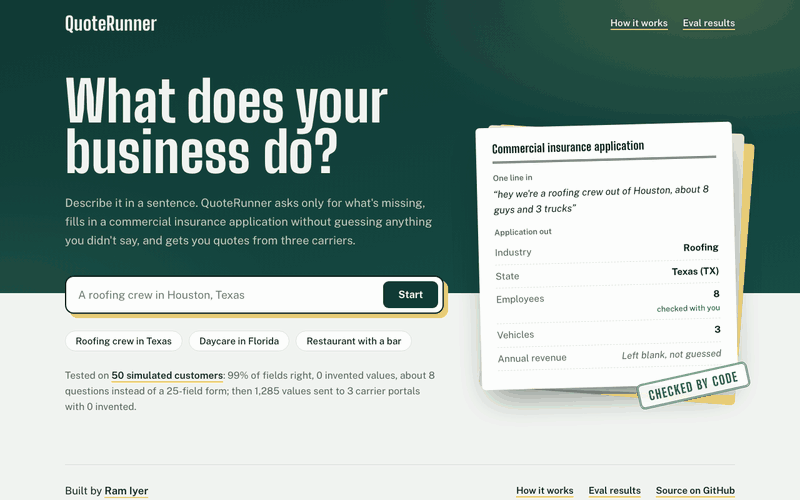
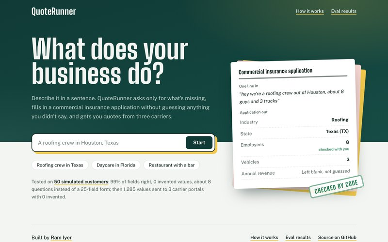
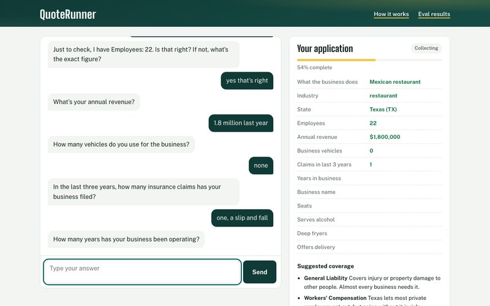
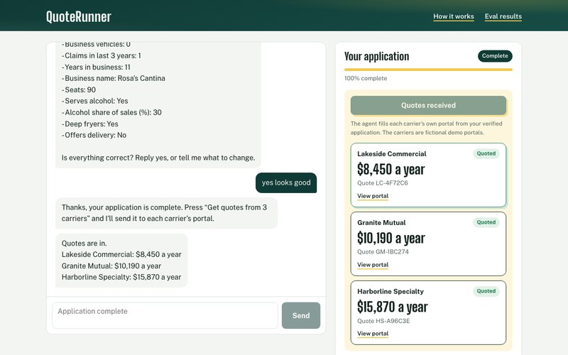
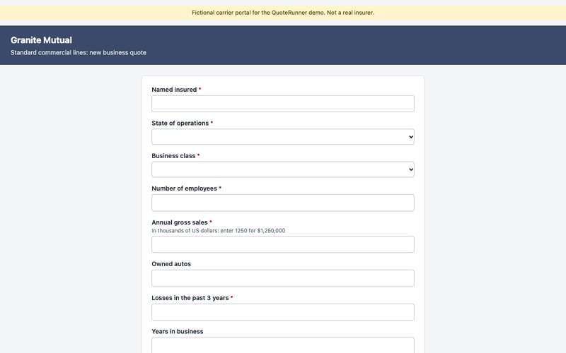
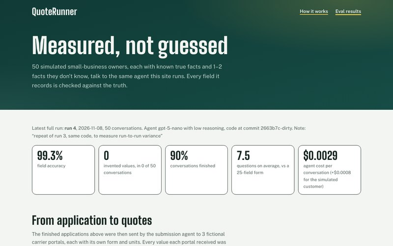
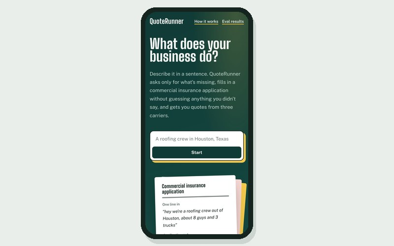
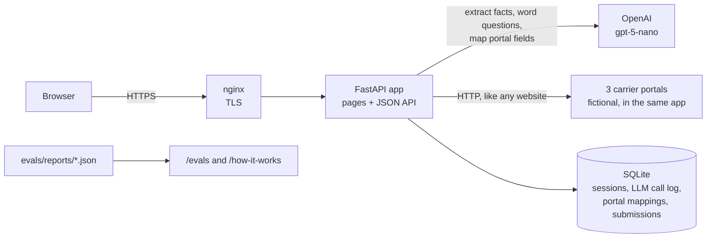
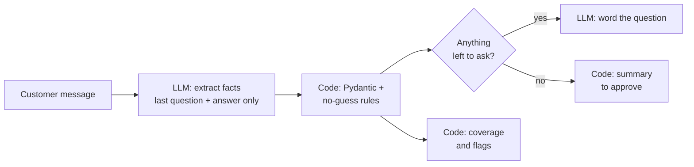
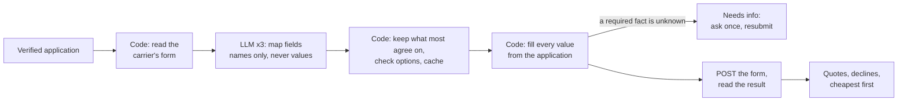

# QuoteRunner: one sentence in, three carrier quotes out

Describe a small business in plain language, like *"we're a roofing crew out of Houston, about 8 guys and 3 trucks"*, *"I run a home daycare in Orlando"* or *"Mexican restaurant in Austin, about 22 staff"*. QuoteRunner asks only for what's missing and fills in a verified commercial insurance application (ACORD 125-style), without guessing anything you didn't say. Then it submits the application to three carrier portals and brings back the quotes, cheapest first.

[](https://github.com/iyerbrah/QuoteRunner/actions/workflows/ci.yml)
[](https://github.com/iyerbrah/QuoteRunner/actions/workflows/eval.yml)
[](https://quoterunner.ramiyer.tech/)
[](LICENSE)
[](pyproject.toml)

**[Try the live demo →](https://quoterunner.ramiyer.tech/)** · [How it works](https://quoterunner.ramiyer.tech/how-it-works) · [Eval results](https://quoterunner.ramiyer.tech/evals) · Built by [Ram Iyer](https://github.com/iyerbrah)



## Highlights

- **The model reads, code decides.** An LLM pulls facts out of each message. Pydantic validates every value, and plain Python chooses the next question, writes the summary and suggests coverage, so a made-up value can't reach the application.
- **No guessing, enforced in code.** "I don't know" counts only for the question just asked, a saved answer changes only when we asked about it, vague numbers ("about a dozen") are confirmed before they're saved, and a business name must be made of words the customer typed. Each rule came from a transcript where the model invented something.
- **A submission agent that reads carrier portals.** It reads each carrier's quote form like any website. The model only maps form fields to the application, kept only where most of 3 independent samples agree; code fills every value, with units taken from the form's own words. 1,285 values sent across 252 submissions: 100% correct, 0 invented.
- **Measured with simulated customers.** 50 business owners with known true facts (typos, vague numbers, changed answers, facts they don't know) talk to the same code the site runs: 99.3–99.8% field accuracy, about 7 questions instead of a 25-field form.
- **Every result is public.** [/evals](https://quoterunner.ramiyer.tech/evals) shows each conversation field by field, and every report is committed in [evals/reports/](evals/reports/).
- **Shipped like a team.** Small PRs with CI on each one (192 tests and an offline eval check), a protected `main`, and its own Ubuntu server with HTTPS, per-call cost tracing and spend caps, at about $0.003 per conversation.

**Stack:** Python 3.12 · FastAPI · Jinja2 + vanilla JS · Pydantic v2 · OpenAI `gpt-5-nano` (forced tool calls) · SQLite (SQLModel) · httpx · pytest · GitHub Actions · nginx + systemd on an Ubuntu VPS

| Describe it in one line | Only what's missing, checked as you go | Quotes from three carriers |
| --- | --- | --- |
|  |  |  |

| A carrier's own quote form | Every eval result in public | Works on a phone |
| --- | --- | --- |
|  |  |  |

## Architecture



- **`POST /api/chat`** takes one customer message and returns the reply and the application so far.
- **`POST /api/sessions/{id}/quotes`** submits the finished application to every carrier, and accepts answers to anything a carrier needs that the customer didn't know.
- **`GET /api/sessions/{id}/application.json`** downloads the validated application.
- **`GET` and `POST /portals/{carrier}`** are the three fictional carriers' quote forms.
- **Limits:** 40 messages per conversation, 1,000 characters per message, 20 requests a minute per address, and LLM spend caps per conversation and per day. Every LLM call is logged with tokens, cost and latency.

## How the intake agent works

1. **Read the message** (1 LLM call). The model sees only the last question and the customer's answer, and returns a forced tool call with the facts stated, the ones that were vague, and the ones the customer doesn't know.
2. **Check it in code.** Pydantic validates each value: real US states ("Texas" becomes TX), sane numbers, known industries. Then the no-guess rules above.
3. **Pick the next question.** A fixed priority order, plus typed follow-ups per industry: a roofer is asked roof height and torch-down work, a daycare its licensed capacity and pool. Anything answered, unknown or not applicable is skipped.
4. **Word it** (1 LLM call), or, when nothing is left to ask, **write the summary in code** for the customer to approve or correct.
5. **Coverage and flags** come from plain-Python rules a broker can read: roofs over 40 ft, torch-down work, alcohol over half of sales, two or more recent claims.



## How the submission agent works

Once the customer approves, the agent takes the application to every carrier at once:

1. **Read the form.** It fetches the carrier's quote form over HTTP and reads its fields, labels, dropdown options and hints in code.
2. **Map the fields** (3 LLM calls in parallel, once per portal). Each sample says which application field holds each form field's fact, and how to convert it. The model sees names and labels, never values. Code keeps only what most samples agree on, checks every option exists on the form, and caches the result by a hash of the form, so a portal that changes its form is mapped again.
3. **Fill it in code.** Every value comes from the verified application. Units come from the form's own words (a form that says "in thousands" gets dollars / 1000). A required fact the owner didn't know stops the submission as "needs info" instead of being guessed.
4. **Submit and read the answer**: a quote with its premium, a decline with the carrier's reason, or "not offered" when the carrier has no class for the business.
5. **Follow up once.** If carriers need something the customer didn't know (usually revenue), the customer is asked once, the answer is validated like any other, and those carriers are resubmitted.



The carriers (Granite Mutual, Harborline Specialty and Lakeside Commercial) are fictional, because real carriers only give portal access to licensed, appointed brokers. They differ the way real ones do: field names, revenue in dollars on one and in thousands on another, their own class names, appetite and pricing. The agent knows none of that in advance.

## Key decisions

- **Two LLM calls per message, one job each.** One extracts facts as a forced tool call (structured JSON, no text parsing); the other only words the next question. Each prompt is simpler and can be evaluated on its own.
- **Extraction sees only the last question and answer.** With the whole conversation, the model kept re-filling the form from old messages and overwrote answers.
- **Code writes everything that lands on the application:** the summary, the coverage and flags, and every value sent to a carrier.
- **Consensus, not one guess, for portal mappings.** With a single mapping call, one run sent 11 invented values to carriers (roofers filed as restaurants). Keeping only what 2 of 3 samples agree on took it to 0. Disagreement becomes "not offered" or "needs info".
- **Industries are data.** Each industry is one entry of typed follow-up questions with `only_if` conditions; adding one needs no other code change, and a test proves it.
- **Measured against ground truth, not vibes.** 50 seeded personas with known facts, scored field by field; the eval runner calls the same `handle_message()` as the website, and ground truth converts values with its own code so it can't share the agent's bugs.
- **One small app on its own server.** FastAPI and SQLite behind nginx, with the carrier portals in the same app: no services to run, and the whole thing deploys with one script.

## Evaluation

### Intake agent

`python -m evals.run` plays 50 simulated small-business owners against the real agent. Each has known true facts for every field that applies, 1–2 facts they genuinely don't know, and one of 7 speaking styles: terse, rambling, typo-heavy, many facts at once, vague numbers, state names spelled out, or changing an answer midway. An LLM plays each owner from a fact card. Every finished application is scored field by field against the truth.

Latest runs (Nov 8, 2026, gpt-5-nano). Runs 3 and 4 use identical code, so the ranges show run-to-run variation:

| Metric | How it's measured | Result | Target |
| --- | --- | --- | --- |
| Field accuracy | Every field that applies to the business, against the true facts | **99.3–99.8%** | ≥ 95% |
| Invented values | Fields filled that the owner couldn't have stated (didn't know it, or it doesn't apply) | **0–1** in 50 conversations | 0 |
| Conversations finished | An approved application within 25 customer messages | **90–98%** | ≥ 90% |
| Questions asked | Average per conversation | **6.8–7.5**, instead of a 25-field form | < 10 |
| Cost | Agent LLM calls per conversation | **$0.0026–0.0029** (gpt-5-nano), plus $0.0008 for the simulated customer | report |

In insurance, a made-up answer can void a policy, so **invented values** matter more than accuracy. The one invented value (run 3) was the simulated customer stating a fact it was told it didn't know; the scorer counts it against the agent anyway.

<details>
<summary><b>What each change improved</b></summary>

| Run | Change | Accuracy | Invented | Finished | Avg questions |
| --- | --- | --- | --- | --- | --- |
| 2 | first full run | 98.9% | 0 | 78% | 10.8 |
| 3 | after fixing what the transcripts showed | 99.8% | 1 | 98% | 6.8 |
| 4 | same code as run 3, run again | 99.3% | 0 | 90% | 7.5 |

Run 2 looked accurate, but a fifth of the conversations never finished. Reading them showed summary deadlocks: a bakery owner saw "Industry: other" and kept asking to change it, and owners who spell out state names kept rejecting "State: OR". Showing "Oregon (OR)" and leaving out the internal "other" label fixed most of them. Still open: a hint that rescued a misclassified Thai restaurant now makes some bakeries and print shops "restaurants".

</details>

### Submission agent

`python -m evals.quotes` sends every finished application from the latest chat run to all three carriers, follows up once for facts the owner didn't know (the persona "looks them up"), and checks every value each portal **received** against the owner's true facts, using hand-written reference mappings as ground truth.

Latest runs (Nov 10, 2026). Quotes runs 2 and 3 are identical:

| Metric | How it's measured | Result | Target |
| --- | --- | --- | --- |
| Values received correctly | Every field each carrier received, against the true facts after unit conversion | **100%** of 1,285 | 100% |
| Invented values at carriers | Anything a carrier received that the owner never stated | **0** across 252 portal submissions | 0 |
| Decisions | Each carrier's quote or decline, against its own rules applied to the true facts | **100%** match | 100% |
| Businesses quoted | At least one quote, after one follow-up | **45 of 45** (3 before the follow-up) | report |
| Speed and cost | Mapping learned once per portal, then cached | **$0.004** once, then **6 ms** per business | report |

<details>
<summary><b>What each change improved</b></summary>

| Quotes run | Mapping | Values correct at carriers | Invented at carriers | Decisions match |
|---|---|---|---|---|
| 1 | one LLM call per portal | 99.1% | 11 | 88% |
| 2 | 3 samples, keep what most agree on | 100% | 0 | 100% |
| 3 | same as run 2, run again | 100% | 0 | 100% |

Building it, real runs caught the model mapping Lakeside's "Annual revenue ($)" in thousands (so Lakeside saw $1,800 instead of $1.8M), writing dropdown maps backwards, and, in quotes run 1, shifting Lakeside's map by one so roofers were submitted as restaurants. Each became a rule in code (units from the form's words, flipping a backwards map only when that's unambiguous) or the consensus mapping.

</details>

### The eval check on pull requests

Every pull request runs `python -m evals.check` ([eval.yml](.github/workflows/eval.yml)). It replays the latest eval's 45 finished applications through the three portals, with the reference mappings standing in for the model, so it needs no API key and takes about a second. It fails when:
- any invented value would reach a carrier;
- any value a carrier receives is wrong, or any decision differs from the carrier's rules applied to the true facts;
- the numbers drift from the committed report, which then has to be regenerated and committed with the change.

Its own tests break the agent on purpose (revenue not converted to thousands, a blank filled with a typical value) and confirm the check catches both.

## Known limitations

- **Simulated customers are easier than real people,** and once stated a fact they were told they didn't know. The transcripts are public so they can be read, not just scored.
- **Results vary between identical runs** (completion moved from 98% to 90%), because the model can't be made deterministic. The numbers above are ranges, not the best run.
- **gpt-5-nano** is OpenAI's cheapest tool-calling model and occasionally misses vague wording a larger model would catch. The model is one line in `.env`.
- **Three industries** have follow-up questions (roofing, daycare, restaurant); everything else gets the base questions only.
- **The carriers are fictional,** and their portals are plain HTML forms. Real portals sit behind broker logins and often need a browser; the same read-map-fill design would drive a headless browser instead of HTTP.
- **It's a demo:** it doesn't bind policies or give advice, and the per-address rate limit is kept in memory.

## Repository tour

| Path | What's there |
| --- | --- |
| [`app/agent/intake.py`](app/agent/intake.py) | The intake agent: extraction, the no-guess rules, the collecting → confirming → done state machine |
| [`app/agent/questions.py`](app/agent/questions.py), [`app/agent/schema.py`](app/agent/schema.py) | The question order and industry follow-ups, and the ACORD 125-style application validated by Pydantic |
| [`app/agent/rules.py`](app/agent/rules.py) | Coverage suggestions and hard-to-place flags, as plain rules |
| [`app/agent/submit.py`](app/agent/submit.py) | The submission agent: read a form, consensus mapping, fill, submit, read the result |
| [`app/carriers.py`](app/carriers.py) | The three fictional carriers: their forms, appetite and pricing |
| [`app/llm.py`](app/llm.py), [`app/config.py`](app/config.py) | The only LLM client: cost per call, spend caps, the call log; models, prices and limits |
| [`app/main.py`](app/main.py), [`app/templates/`](app/templates/), [`app/static/`](app/static/) | Routes, pages and the chat UI |
| [`evals/`](evals/) | Personas, the simulated customer, both evals, the reference mappings, the PR check and every saved report |
| [`tests/`](tests/) | 192 tests with a fake model: agents, portals, evals, web, deploy files, README numbers |
| [`deploy/`](deploy/) | The systemd unit, nginx site, deploy script and server runbook |
| [`.github/workflows/`](.github/workflows/) | CI and the eval check on every PR |

**More documentation:**
- [How it works](https://quoterunner.ramiyer.tech/how-it-works): the short version, with the latest numbers.
- [deploy/README.md](deploy/README.md): running the server.

## Run locally

You need Python 3.12 or newer and an OpenAI API key.

```bash
python3 -m venv .venv
.venv/bin/pip install -r requirements.txt
cp .env.example .env                        # then add OPENAI_API_KEY
.venv/bin/uvicorn app.main:app --reload     # http://localhost:8000 (on another port, set PORTAL_BASE_URL)
```

```bash
.venv/bin/pytest -q                         # all tests, no API key needed: the model is faked
.venv/bin/python -m evals.check             # the PR eval check (offline, about a second)
.venv/bin/python -m evals.run --limit 5     # a 5-persona chat eval against the real model (about $0.02)
.venv/bin/python -m evals.run               # all 50 personas (about 6 minutes, about $0.17)
.venv/bin/python -m evals.quotes            # send the latest finished applications to the 3 portals
.venv/bin/python -m app.agent.intake        # chat with the agent in the terminal
```

## Deploy

The live site, [quoterunner.ramiyer.tech](https://quoterunner.ramiyer.tech), runs on an Ubuntu VPS: nginx with a Let's Encrypt certificate in front, the FastAPI app under uvicorn as a systemd service, and SQLite on disk. A redeploy is one script, `deploy/deploy.sh`: pull, install, restart, health check, stopping at the first failure. [deploy/README.md](deploy/README.md) has the first-time setup and day-to-day commands.

## License

The code is under the [MIT license](LICENSE). QuoteRunner is a portfolio demo, not an insurance product: it doesn't sell, quote or bind insurance, isn't affiliated with any insurer or broker, and its coverage suggestions are general rules, not advice. The carriers and the businesses in the evals are fictional.
