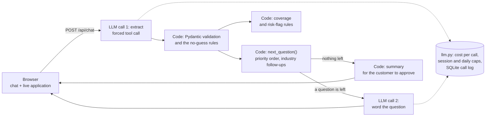
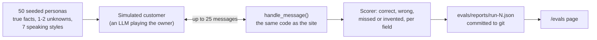

# QuoteRunner

An AI agent that turns a one-line description of a small business into a verified commercial
insurance application (ACORD 125-style), asking only for what's missing and never guessing.

**[Live demo](https://quoterunner.ramiyer.tech)** · [How it works](https://quoterunner.ramiyer.tech/how-it-works) ·
[Eval results](https://quoterunner.ramiyer.tech/evals) · 60-second demo video (link coming)


## Results

Measured on 50 simulated small-business owners talking to the same code the site runs
([every conversation is public](https://quoterunner.ramiyer.tech/evals)). The two latest full runs use
identical code, so the ranges show run-to-run variation, not cherry-picking.

| | Runs 3 and 4 |
|---|---|
| Field accuracy | **99.3–99.8%** |
| Invented values (a field filled that the owner never stated) | **0–1** in 50 conversations |
| Conversations finished | **90–98%** |
| Questions asked | **6.8–7.5**, instead of a 25-field form |
| Cost per conversation | **$0.0026–0.0029** (gpt-5-nano), plus $0.0008 for the simulated customer |

In insurance, a made-up answer can void a policy, so **invented values** is the number that matters
most: every persona has 1–2 facts they genuinely don't know, and any guess shows up in the score.

## How it works

One customer message, end to end:



How the numbers above are produced:



## Design decisions

- **Two LLM calls, one job each.** One extracts facts as a forced tool call (structured JSON, no text
  parsing); the other only words the next question. Each prompt is simpler, more reliable and
  separately testable.
- **The model reads; code decides.** Which question comes next, when the form is complete, what the
  summary says, which coverage to suggest: all plain, tested Python. The model never writes anything
  that lands on the application without passing through code.
- **No-guess rules, enforced in code, not just asked for in the prompt.** Extraction sees only the
  last question and answer, so it can't re-fill the form from old messages. "I don't know" counts only
  for the question just asked. A saved answer changes only when we asked about it. A business name or
  description must be made of words the customer actually typed. Each rule came from a real transcript
  where the model invented something.
- **Validation in Pydantic.** Every value is checked before it's saved: real US states ("Texas"
  becomes TX), sane numbers, known industries. Invalid answers are dropped and asked again.
- **Vague numbers are confirmed, not trusted.** "About a dozen" is held back and read back to the
  customer before it's saved.
- **Coverage and flags are rules, not AI.** Suggestions must be predictable and explainable to a
  broker (roofs over 40 ft, torch-down work, alcohol over half of sales).
- **Industries are data.** Each industry is one entry of typed follow-up questions with `only_if`
  conditions; adding one needs no other code change (there's a test for that).
- **Measured with simulated customers.** 50 seeded personas with ground truth, scored field by field.
  The eval runner calls the same `handle_message()` as the website.
- **Cost controls.** Every LLM call is logged with tokens, cost and latency. Per-session and daily caps
  stop the app politely; messages per session and per IP are capped too.

## What the evals caught

| Run | Change | Accuracy | Invented | Finished | Avg questions |
|---|---|---|---|---|---|
| 2 | first full run | 98.9% | 0 | 78% | 10.8 |
| 3 | after fixing what the transcripts showed | 99.8% | 1 | 98% | 6.8 |
| 4 | same code as run 3, run again | 99.3% | 0 | 90% | 7.5 |

Run 2 looked accurate but a fifth of the conversations never finished. Reading them showed summary
deadlocks: a bakery owner saw "Industry: other" and kept asking to change it, and owners who spell out
state names kept rejecting "State: OR". Showing "Oregon (OR)" and leaving out the internal "other"
label fixed most of them. Still open: a hint that rescued a misclassified Thai restaurant now makes
some bakeries and print shops "restaurants", and in one run the simulated customer stated a fact it was
told it didn't know (the scorer counts it against the agent anyway).

## Run it locally

Needs Python 3.12+ and an OpenAI API key.

```bash
python3 -m venv .venv
.venv/bin/pip install -r requirements.txt
cp .env.example .env                        # then add OPENAI_API_KEY
.venv/bin/pytest -q                         # all tests, no API key needed: the LLM is faked
.venv/bin/uvicorn app.main:app --reload     # http://localhost:8000
.venv/bin/python -m evals.run --limit 5     # a quick 5-persona eval, about $0.02
```

Deploying to a server (systemd, nginx, Let's Encrypt): see [deploy/README.md](deploy/README.md).

## Project layout

```
app/
  main.py            FastAPI routes: chat page, /api/chat, /how-it-works, /evals, /healthz
  llm.py             the only LLM client: cost per call, spend caps, call log
  config.py          models, prices, caps (from .env)
  db.py              SQLite tables: LLM calls, chat sessions, eval runs
  agent/
    intake.py        extraction, no-guess rules, state machine (collecting, confirming, done)
    questions.py     question order, INDUSTRY_QUESTIONS, next_question()
    schema.py        the ACORD 125-style Submission, validated by Pydantic
    rules.py         coverage suggestions and hard-to-place flags
evals/               personas, simulated customer, scorer, runner, committed reports
deploy/              systemd unit, nginx site, deploy.sh
tests/               pytest, LLM faked
```

## Limitations

- Simulated customers are easier than real people, and they occasionally leak facts. The transcripts
  are published so they can be read, not just scored.
- Results vary between identical runs (completion moved from 98% to 90%), because the model can't be
  made deterministic. Quote ranges, not the best run.
- gpt-5-nano is OpenAI's cheapest tool-calling model; it occasionally misses vague wording that a
  larger model would catch. The model is one line in `.env`.
- Three industries have follow-up questions (roofing, daycare, restaurant); everything else gets the
  base questions only. The per-IP rate limit is kept in memory.
- It's a portfolio demo, not an insurance product: it doesn't quote, bind or give advice.

## What's next

- **A carrier-portal submission agent** that takes this verified application as its input, the next
  step in a broker's workflow.
- Fix the restaurant over-classification and rerun the evals.
- More industries, and a few real (consented) conversations to check the simulated ones against.

## Credits

Built by [Ram Iyer](https://github.com/iyerbrah), with Claude Code as a pair programmer: every step was
planned, reviewed and tested in turn (see the commit history). The starting prototype is in
`reference/starter/`.
